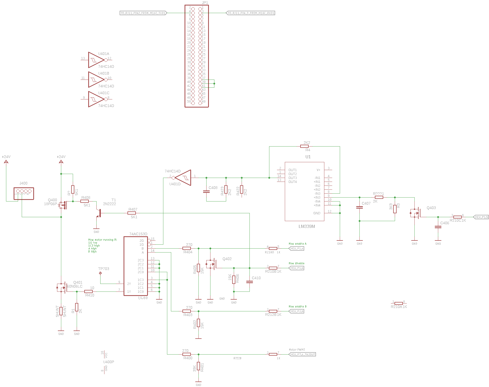

## Reverse engineered schematic in Kicad for PCG5000G1 mainboard used in the Robomow RM-400/City-110/RM-510 lawn mower 

I had been repairing a Robomow RM-510 lawn mower which mowing motor does not works. Test fails with error 55.

*(In the case if you ran into the error 55 issue check the lid close checking Hall sensor...)*

The same board is present in the RM-200 (at least it is possible to set it in the service menu)

The main focus of my work is the mowing motor driving circuit:



Later on I started to dream about integrating the robot into [OpenMower](https://github.com/ClemensElflein/OpenMower).

Due to the limitations of the factry firmware at some point I would like to write a replacement firmware for it in [Mowgli style](https://github.com/cloudn1ne/Mowgli).


### IR remote 


IR receiver type is unknown the following is present on it's back:

```
3    
8   K
   O S 
    C

```

### General thoughts

* MCU is clocked from a 16 MHz crystal
* IR remote receiver IC OC output is connected to the MCU's P2.5 pin (INPC15)
* Timer1 used for measuring time interupts on the INPC15
* Timer1 has 160 prescaler -> 1 timer increment == 10 us 100 kHz-n jár
* Timer1 CH5 set to measure time on both edges (`MOV.B   #3, g1tmcr5     ; CH5 on IR input measure both edges`)
* Upon IC interrupt:
    * The timer value (G1TM5) stored 
    * The time difference from the last impulse lenght is calculated (current width - prev width)
    * Check if the current is longer than 4560 us + the previous

* Timer1 overflow interrupt generated when the 15th bit overflows (G1BCR0 IT set to 0)
* Timer1 overflow has a timeout counter variable which incremented in the overflows 2 times
    * timer_counter_1,2, ir_timeout_counter counts 0-1-2 (after 0ms - 655,35ms - 1310,7ms)

    
